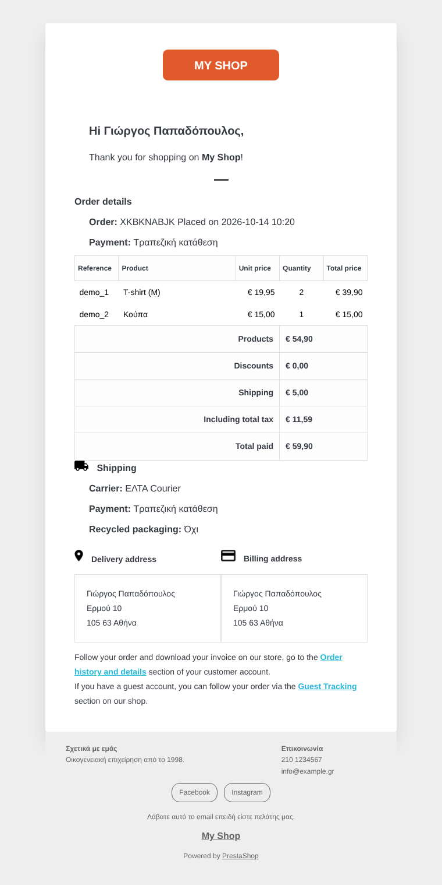
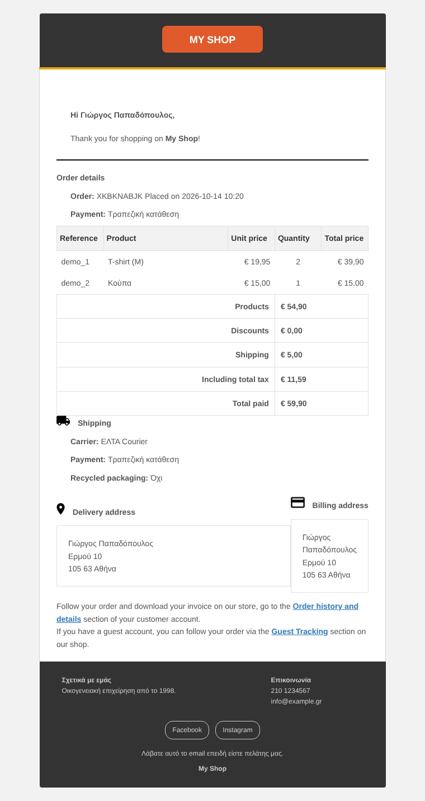
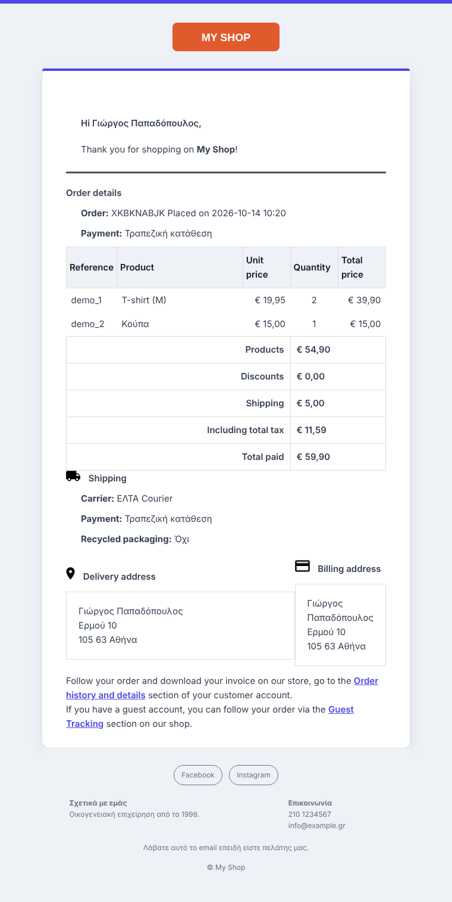
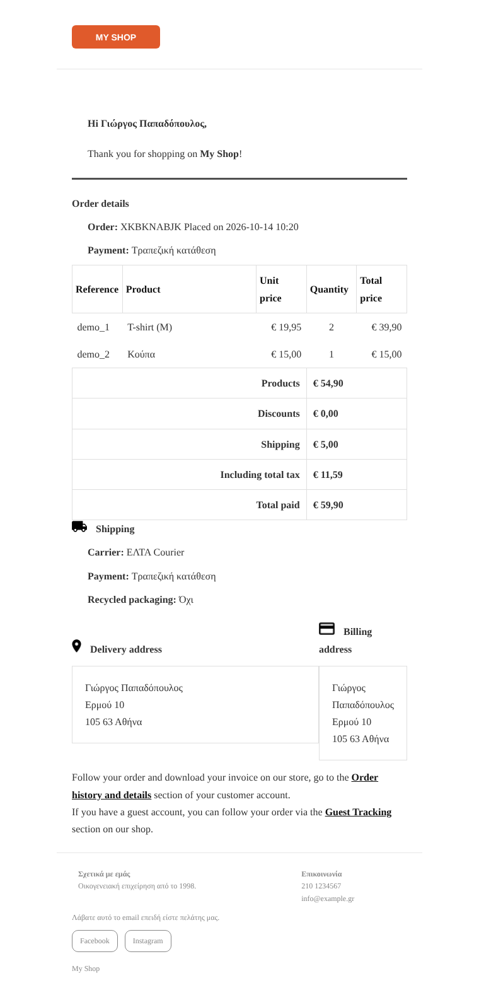
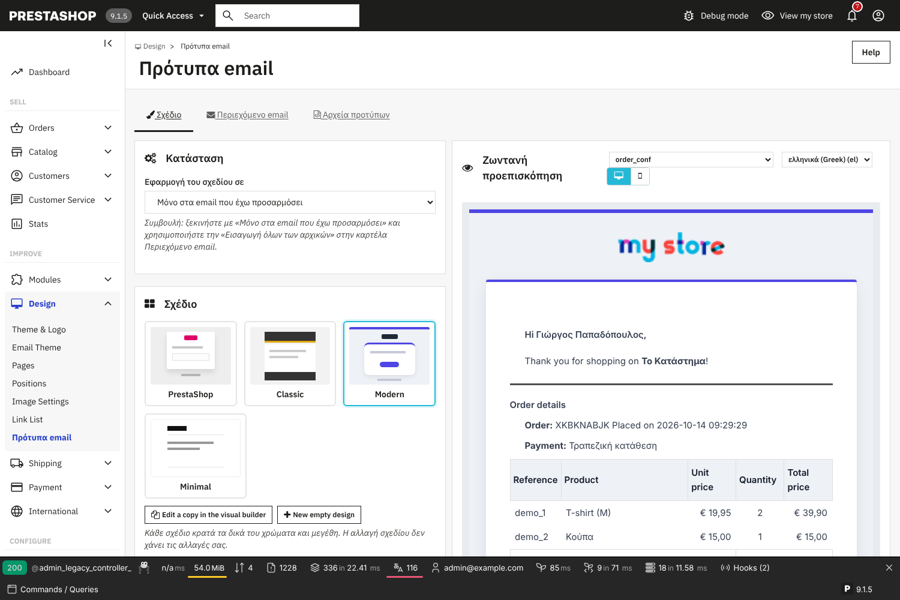
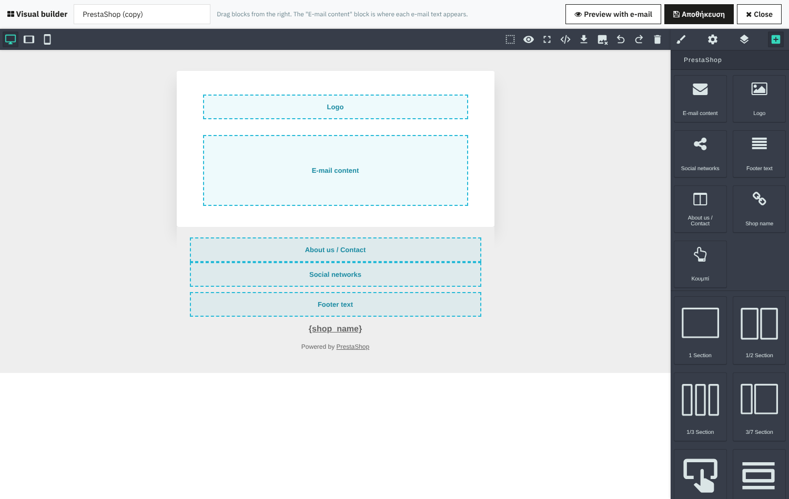

# Mail Template Editor για PrestaShop 1.7 / 8 / 9

Module για επεξεργασία των email του PrestaShop (πελατών και διαχειριστών) **με σωστά ελληνικά**
και επιλογή ανάμεσα σε **4 έτοιμα σχέδια** (PrestaShop, Κλασικό, Μοντέρνο, Μινιμαλιστικό), με δικά σας χρώματα,
γραμματοσειρές, μεγέθη γραμμάτων και διάταξη, ή **δικά σας σχέδια με drag & drop builder**.

| PrestaShop | Κλασικό | Μοντέρνο | Μινιμαλιστικό |
|---|---|---|---|
|  |  |  |  |

(Όλες οι εικόνες δείχνουν το πραγματικό email επιβεβαίωσης παραγγελίας του PrestaShop.)





## Τι κάνει

**1. Σχέδιο (καρτέλα «Σχέδιο»)**
- 4 έτοιμα σχέδια. Το «PrestaShop» έχει την ίδια εμφάνιση με τα προεπιλεγμένα email του PrestaShop
  (και κρατά τη μορφοποίηση του αρχικού περιεχομένου). Κάθε σχέδιο κρατά τις δικές του ρυθμίσεις.
- **Οπτικός builder (drag & drop)**: «Επεξεργασία αντιγράφου στον οπτικό builder» για οποιοδήποτε σχέδιο ή
  «Νέο κενό σχέδιο». Ενότητες 1/2/3 στηλών, κείμενο, εικόνες, κουμπιά, διαχωριστικά, παραθέσεις, λίστες, και
  ειδικά στοιχεία: **Περιεχόμενο email**, Λογότυπο, Κοινωνικά δίκτυα, Κείμενο υποσέλιδου, Σχετικά/Επικοινωνία,
  Όνομα καταστήματος. Προεπισκόπηση με πραγματικό email πριν την αποθήκευση. Όσα σχέδια θέλετε.
- 13 χρώματα: σελίδα, κεφαλίδα, τόνος, περιεχόμενο, κείμενο, επικεφαλίδες, σύνδεσμοι, κουμπιά, περιγράμματα, υποσέλιδο.
- Γραμματοσειρά (9 ασφαλείς για email), μέγεθος κειμένου, επικεφαλίδων, υποσέλιδου, ύψος γραμμής, κεφαλαίες επικεφαλίδες.
- Πλάτος email, στρογγυλεμένες γωνίες, λογότυπο (εμφάνιση, πλάτος, θέση), όνομα καταστήματος.
- Υποσέλιδο ανά γλώσσα: «Σχετικά με εμάς», «Επικοινωνία», ελεύθερο κείμενο, κοινωνικά δίκτυα.
- Ζωντανή προεπισκόπηση (υπολογιστής / κινητό) με **το πραγματικό περιεχόμενο** οποιουδήποτε email (επιλογή από λίστα).
- Εφαρμογή: πουθενά / μόνο στα email που προσαρμόσατε / σε όλα τα email. Υπάρχει και λίστα εξαιρέσεων.

**2. Περιεχόμενο email (καρτέλα «Περιεχόμενο email»)**
- Λίστα με όλα τα email: του PrestaShop, όλων των modules και τα overrides του θέματος, ανά γλώσσα.
- Οπτικός επεξεργαστής (TinyMCE του PrestaShop), κώδικας HTML ή **οπτικός builder** (drag & drop).
- Προαιρετικό **δικό σας θέμα (subject)** ανά email και γλώσσα, με μεταβλητές (π.χ. `Παραγγελία {order_name}`).
- «Εισαγωγή αρχικού περιεχομένου»: παίρνει το αρχικό email **με όλα του τα στοιχεία** (κείμενα, μεταβλητές,
  εικόνες, συνδέσμους, πίνακες) και αφαιρεί μόνο ό,τι δίνει το σχέδιο: λογότυπο, πλαίσιο, υποσέλιδο, «powered by».
  Με τα άλλα σχέδια αφαιρούνται και οι παλιές γραμματοσειρές/χρώματα, ώστε να εφαρμοστεί το νέο σχέδιο.
  Ελέγχεται αυτόματα σε όλα τα email του PrestaShop 8.2 και 9.1 (core + modules) ότι δεν χάνεται τίποτα.
- «Εισαγωγή όλων των αρχικών» με ένα κλικ.
- Κουμπιά για εισαγωγή κουμπιού και πλαισίου, και κλικ στις μεταβλητές του email για να μπουν στο κείμενο.
- Προεπισκόπηση και **δοκιμαστική αποστολή** μέσω του PrestaShop.
- Η εκδοχή απλού κειμένου (txt) δημιουργείται αυτόματα.

**3. Αρχεία προτύπων (καρτέλα «Αρχεία προτύπων»)**
- Απευθείας επεξεργασία των αρχείων `.html .txt .tpl .twig .css` (core, modules, θέμα, mail themes του 1.7.6+).
- **Αντίγραφο ασφαλείας πριν από κάθε αποθήκευση** (κρατούνται τα 20 τελευταία ανά αρχείο) και επαναφορά.
- Εμφανίζει την κωδικοποίηση του αρχείου και αποθηκεύει **πάντα σε UTF-8**.

## Γιατί τα ελληνικά δεν χαλάνε πια

Ο ενσωματωμένος editor χαλάει τα ελληνικά κυρίως για τρεις λόγους, και το module τους αποφεύγει όλους:

| Πρόβλημα | Τι κάνει το module |
|---|---|
| Το κείμενο περνά από φίλτρα εισόδου (`Tools::getValue` κάνει `stripslashes`/`urldecode`, κάποιοι servers έχουν mod_security) | Το περιεχόμενο στέλνεται από τον browser σε **base64** και αποκωδικοποιείται χωρίς καμία επεξεργασία |
| Ο editor μετατρέπει τα ελληνικά σε entities (`&alpha;`, `&#945;`) ή σε άλλη κωδικοσελίδα | Ο TinyMCE ρυθμίζεται με `entity_encoding: raw`. Όλα αποθηκεύονται ως **καθαρό UTF-8** (βάση `utf8mb4`, αρχεία χωρίς BOM) |
| Υπάρχουν ήδη χαλασμένα αρχεία (Windows-1253, ISO-8859-7, «ÎšÎ±Î»Î·Î¼Î­Ïα») | Αυτόματη αναγνώριση κωδικοποίησης και κουμπί **«Διόρθωση ελληνικών χαρακτήρων»**, που επαναφέρει ακόμη και διπλο-χαλασμένο κείμενο |

## Πώς δουλεύει (χωρίς override)

Το module **δεν αλλάζει αρχεία του PrestaShop** και δεν χρησιμοποιεί override του `Mail.php`, σε αντίθεση με
τα παλιά modules του 1.6. Χρησιμοποιεί δύο επίσημα hooks της `Mail::send()`:

- `actionEmailSendBefore`: εντοπίζει ποιο email στέλνεται (και από ποιο module) και βάζει το δικό σας θέμα.
- `actionEmailAddAfterContent`: «ντύνει» το περιεχόμενο με το επιλεγμένο σχέδιο.

Οι μεταβλητές (`{firstname}`, `{products}`, `{shop_logo}` ...) μένουν ανέγγιχτες και τις συμπληρώνει το
PrestaShop όπως πάντα. Αν προκύψει οποιοδήποτε σφάλμα, το email φεύγει κανονικά με το αρχικό του περιεχόμενο
και το σφάλμα καταγράφεται στα logs.

Οι μεταβλητές που το PrestaShop αντικαθιστά με γραμμές πίνακα (π.χ. `{products}`, `{discounts}`) φαίνονται
στον κώδικα ως `<!--mte:{products}-->`, για να μη τις μετακινεί ο editor έξω από τον πίνακα. Στην αποστολή
επανέρχονται αυτόματα.

## Εγκατάσταση

1. `./build.sh` (ή συμπιέστε τον φάκελο `mailtemplateeditor/` σε `mailtemplateeditor.zip`).
2. Back office → **Modules → Module Manager → Upload a module** → επιλέξτε το zip.
3. Το module εμφανίζεται στο **Σχέδιο → Πρότυπα email**.

Προτεινόμενη σειρά:
1. Καρτέλα «Σχέδιο»: διαλέξτε σχέδιο και χρώματα και πατήστε «Αποθήκευση σχεδίου».
2. Καρτέλα «Περιεχόμενο email»: επιλέξτε γλώσσα και πατήστε «Εισαγωγή όλων των αρχικών».
3. Διορθώστε τα κείμενα όπου χρειάζεται και στείλτε δοκιμαστικά email.

## Συμβατότητα

- PrestaShop 1.7.x, 8.x, 9.x. Δοκιμάστηκε από άκρη σε άκρη σε **PrestaShop 9.1.5** και **8.2.0** (PHP 8.3, MariaDB):
  εγκατάσταση, αναβάθμιση από 1.0 με ανέβασμα zip, builder, αποθήκευση και πραγματική αποστολή email μέσω SMTP
  με ελληνικό θέμα και κείμενο.
- PHP 7.1 ή νεότερη.
- Για PrestaShop 1.6 δεν είναι συμβατό.

## Δομή

```
mailtemplateeditor/
  mailtemplateeditor.php            κύρια κλάση, εγκατάσταση, hooks
  controllers/admin/...Controller   σελίδα διαχείρισης + AJAX
  classes/MteEncoding.php           UTF-8, αναγνώριση/διόρθωση κωδικοποίησης
  classes/MteContentExtractor.php   εξαγωγή περιεχομένου από τα αρχικά email
  classes/MteDesign.php             σχέδια, ρυθμίσεις, rendering, txt
  classes/MteScanner.php            εύρεση αρχείων email (core / modules / θέμα), ασφάλεια διαδρομών
  classes/MteRepository.php         πίνακας ps_mte_template (utf8mb4)
  views/layouts/{prestashop,classic,modern,minimal}.html   τα 4 έτοιμα σχέδια
  views/lib/grapesjs/               GrapesJS 0.23.6 + preset newsletter 1.0.2 (BSD-3-Clause) για τον builder
  upgrade/upgrade-1.1.0.php         αναβάθμιση από 1.0 (πίνακας ps_mte_layout για τα δικά σας σχέδια)
  translations/el.php               ελληνική μετάφραση της διαχείρισης
tests/run.php                       tests χωρίς PrestaShop: php tests/run.php
```

Για νέο σχέδιο: προσθέστε ένα αρχείο στο `views/layouts/`, το όνομά του στο `MteDesign::LAYOUTS` και
προεπιλογές στο `MteDesign::defaults()`.
